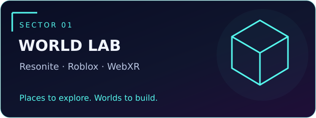
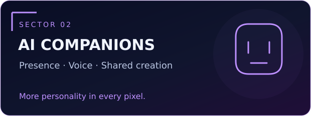
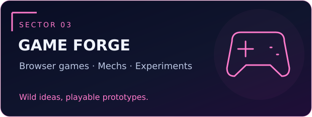
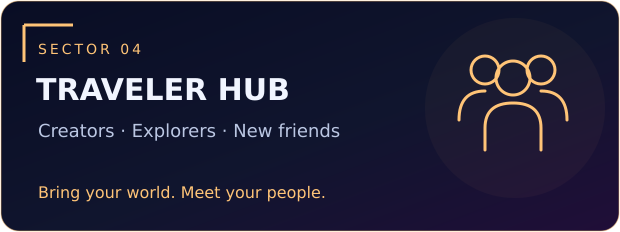

# 🌌 Rodorin Lab × HOLOVERSE

**AI companions. Virtual worlds. Games with a wild imagination.**

人とAIが一緒に遊び、つくり、出会う。そんな世界を、実験しながら育てています。

[🌍 Join the Travelers](https://www.facebook.com/groups/1231558456489278) · [🎮 Explore the games](#-the-prototype-hangar) · [🧭 Pick a sector](#-choose-your-destination) · [🇯🇵 日本語](#-ロドリンの研究所へようこそ)

---

## 🛰️ Incoming transmission

Hey, I'm **Rodorin**, an independent creator from Japan. Welcome to my slightly overexcited corner of the universe. 👋

I'm building **HOLOVERSE**: a growing creative project exploring **AI companions, VR spaces, games, avatars, and shared experiences**. I love the moment a ridiculous idea becomes something you can actually walk into, talk to, or play.

My AI companions are creative partners in that journey. We experiment, build prototypes, get things spectacularly wrong, and try again. The fun is in making things together.

> **What if your desktop could become a doorway to a world you build with your AI friends?**

That's the kind of question that keeps this lab moving. 🚀

## 🧭 Choose your destination

<table>
<tr>
<td width="50%">

</td>
<td width="50%">

</td>
</tr>
<tr>
<td width="50%">

</td>
<td width="50%">

</td>
</tr>
</table>

### 🌐 World lab

**The current frontier: HOLOVERSE.**

- **Resonite** — exploring shared spaces, avatars, and creating inside VR.
- **Roblox** — building out new world and game experiments.
- **WebXR & browser 3D** — exploring ways to step from a browser into an immersive space.
- **Development streams** — sharing the building process, discoveries, and delightful chaos.

These are evolving experiments. The interesting part is watching a world take shape.

### 🤝 AI companions

I'm interested in AI with **presence, personality, and a place in the creative process**.

That means exploring voice conversations, avatars, shared screens, and spaces where we can create together. Local models and cloud services both have a place in the workshop.

The dream is simple: **more shared adventures, more surprising ideas, and more things we could never have made alone.**

## 🎮 The prototype hangar

A few public creations from the workshop behind HOLOVERSE. Open a project, peek under the hood, or take the browser RPG for a spin.

| Destination | What's inside | Enter |
| :--- | :--- | :--- |
| 🐉 **Dot Quest** | A little hero, a dragon, and a browser RPG with mobile support | [▶ Play](https://rodorin-lab.github.io/dot-quest-rpg/) · [Source](https://github.com/rodorin-lab/dot-quest-rpg) |
| 🤖 **Mech Parts Frontier** | Customizable mechs, tactical missions, and part-destruction combat | [Open the hangar](https://github.com/rodorin-lab/mech-parts-frontier) |
| 👾 **Invader Game** | An arcade experiment from the game-making journey | [Explore](https://github.com/rodorin-lab/invader-game) |
| 🐾 **Digital Pet** | A companion-themed experiment | [Meet the project](https://github.com/rodorin-lab/digital-pet) |

**[Browse the full repository collection →](https://github.com/rodorin-lab?tab=repositories)**

## 🧪 Ideas in orbit

**Concepts to explore — a wish list for the future of HOLOVERSE.**

| Wild idea | Imagine this… |
| :--- | :--- |
| 🛂 **Traveler Passport** | A little passport collecting memories and stamps from worlds you visit. |
| 🎲 **Portal Roulette** | One jump sends you to an unexpected community creation. |
| 📮 **Companion Postcards** | Avatars sending tiny illustrated memories from shared adventures. |
| 🛠️ **Build a World Together** | A community idea becoming a playable prototype during a stream. |
| 🖼️ **The Living Gallery** | A social space for visitors' games, AI videos, avatars, and strange inventions. |
| 🚀 **Pocket Universe Jam** | A tiny game, one impossible theme, and a wildly creative crew. |

Got a stranger idea? Excellent. You're in the right airlock. 😎

## 🌍 Travelers welcome

**[HOLOVERSE Explorers | AI, VR & Virtual Worlds](https://www.facebook.com/groups/1231558456489278)**

A gathering place for **Travelers**: curious people who love AI, virtual worlds, games, avatars, and making things.

Bring a creation. Share an experiment. Show us a world. You don't need to be an expert to join the adventure. ✨

**Want to help this universe grow?**

- 🎮 Try a project and report bugs in its repository.
- 🧠 Suggest a feature, a world idea, or a surprising collaboration.
- 🎨 Share your creations and meet other Travelers in the community.
- ⭐ Star a project you enjoy, or share it with someone who would love it.

## ⚙️ Workshop ingredients

**Creative code:** JavaScript · TypeScript · Python · React · Three.js  
**Worlds & play:** Resonite · Roblox · WebXR · browser games  
**AI experiments:** companions · voice · local LLMs · creative workflows  
**Home base:** Linux · Gentoo · Hyprland · a love of cyberpunk

The stack changes. The curiosity stays.

## 🇯🇵 ロドリンの研究所へようこそ

**HOLOVERSE**を中心に、AIの仲間たちとVRワールド・ゲーム・アバター・交流空間をつくっています。ResoniteやRoblox、ブラウザの3D空間などを行き来しながら、「こんなものがあったら面白い！」を形にしていく研究所です。🌌

完成品も、制作中の実験も、失敗からの大逆転も、一緒に楽しんでいけたら嬉しいです。作品を見せたい人、アイデアを話したい人、遊びに来たい人、みんな**Travelers（旅人）**として大歓迎！🚀

**[🌍 交流広場へ](https://www.facebook.com/groups/1231558456489278)** · **[🎮 ドット・クエストで遊ぶ](https://rodorin-lab.github.io/dot-quest-rpg/)**

<b>🛂 Open your complimentary Traveler boarding pass</b>

### Boarding pass / HOLOVERSE

| Field | Your ticket |
| :--- | :--- |
| Passenger | You, the curious one |
| Destination | Somewhere we haven't built yet |
| Seat | Beside the creators |
| Baggage allowance | Unlimited imagination |
| Boarding requirement | Bring your curiosity |
| Departure | When someone says “what if…” |

**Achievement unlocked: You found the secret airlock.** 🏆  
旅人さん、ようこそ。次の「やばいもの」を、一緒につくろう。🤣✨

 

Small experiments. Big imagination. / Profile edition: October 2026

